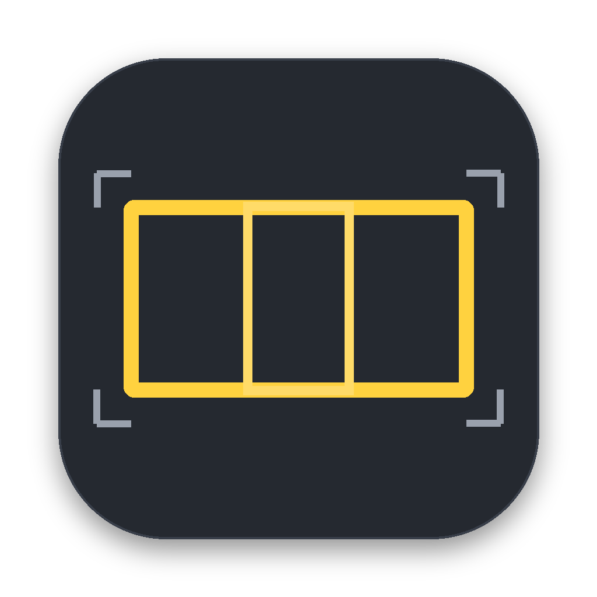
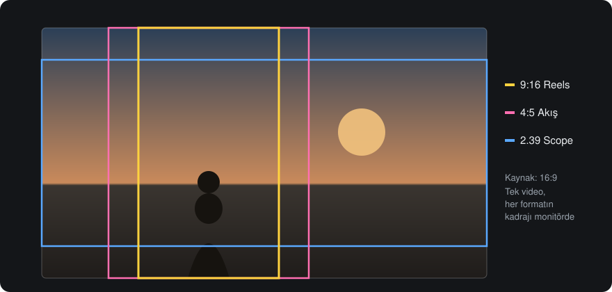
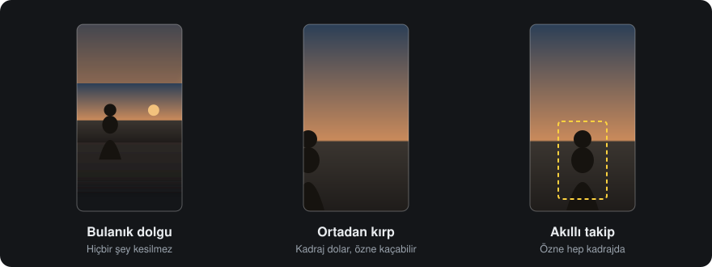

# Teslim Paketi

**Videoyu bir kez sürükle. Teslime hazır paketi al.**

Reels, YouTube, sinema… Tek videodan bütün formatlar aynı anda, sesi ayarlı ve kadrajı akıllıca yerleşmiş halde.

[**İndir**](../../releases/latest) · [Ne yapar?](#ne-yapar) · [Formatlar](#formatlar) · [Kurulum](#indir-ve-kur)

---

## Ne yapar?

Bitmiş bir video, teslimde onlarca farklı boyuta dönüşür. Instagram'a dikey, YouTube'a yatay, festivale scope.
Her birini kurgu programında tek tek açıp kadrajlamak, sesini ayarlamak ve dışa aktarmak saatler alır.

Teslim Paketi bunu tek seferde yapar:

1. **Sürükle.** Bir veya birden fazla videoyu pencereye bırak.
2. **Seç.** İstediğin formatları işaretle. Her formatın kadrajı monitörde renkli çizgilerle görünür.
3. **Başlat.** Seçtiğin klasöre sadece final dosyaları düşer. Fazladan rapor ya da resim gelmez.

## Formatlar

Hepsini aynı anda seçebilirsin.

| | Oran | Nerede kullanılır |
|---|---|---|
| **Sosyal** | 9:16 | Reels · TikTok · Shorts |
| | 4:5 | Instagram akış |
| | 1:1 | Kare gönderi |
| | 2:3 | Pinterest · dikey poster |
| | 3:4 | Dikey klasik |
| **Yatay** | 16:9 | YouTube · TV |
| | 4:3 | Klasik TV |
| **Sinema** | 1.85:1 | Flat (DCI) |
| | 2.35:1 | Scope |
| | 2.39:1 | Scope (DCI) |
| **Orijinal** | kaynak oranı | Sadece ses ve kodlama düzeltilmiş kopya |

**Çözünürlük:** 720p, 1080p veya 4K. Sinema formatlarında istersen siyah bant (letterbox) ekleyebilirsin.

## Farklı orana nasıl yerleşsin?

Yatay bir videoyu dikeye çevirirken kadrajın dışında kalan kısım için üç seçenek var:

- **Bulanık dolgu.** Görüntünün tamamı korunur. Boş kalan alan aynı videonun bulanık haliyle dolar.
- **Ortadan kırp.** Kadraj tamamen dolar. Kenarda kalan özne kesilebilir.
- **Akıllı takip.** Kurgu programlarındaki *auto reframe* gibi çalışır, ama daha sakin ve sinematiktir:
  - Yüzleri, insanları, hayvanları ve nesneleri bulur. Özne hareket etmese bile onu kadrajın merkezine alır.
  - Kamera sarsılmadan, robotik durmadan yumuşakça kayar. Gerekmedikçe hiç kıpırdamaz.
  - Kurgudaki kesmeleri tanır ve her plan için kadrajı yeniden kurar.
  - Kompozisyon kurallarına uyar: bakış yönüne boşluk bırakır, yüzü üst üçte bire koyar, özneyi asla kesmez.

## Teslime hazır

- **Ses:** Tüm çıktılar platform standardı olan **-14 LUFS**'a getirilir. İki geçişli ölçüm yapılır, sessiz kanallar bozulmaz.
- **Filigranlı önizleme** (isteğe bağlı): Onay bekleyen müşteriye göndermek için, `Onizleme` alt klasörüne ayrı kopya.
- **Toplu iş:** Birden çok videoyu sıraya koy, hepsi aynı ayarlarla çıkar.
- **Kaydetme yeri:** Klasörü sen seçersin, uygulama hatırlar.

## Gizlilik

- Dosyaların **bilgisayarından çıkmaz**. Bütün işlem cihazında yapılır.
- Hesap, abonelik, bulut ya da analitik yok.
- ffmpeg ve özne tespit modelleri uygulamanın içinde gelir. İnternet gerekmez.

---

## İndir ve kur

[**Releases**](../../releases/latest) sayfasından bilgisayarına uygun dosyayı indir.

### 🪟 Windows

1. **`TeslimPaketi-Kurulum-….exe`** dosyasını indir ve çift tıkla.
2. "Windows bilgisayarınızı korudu" uyarısı çıkarsa **Ek bilgi → Yine de çalıştır**'a bas.
3. **İleri → Kur → Bitir**. Masaüstündeki **Teslim Paketi** simgesiyle aç.

### 🍎 Mac

1. Hangi dosyayı indireceğini öğrenmek için  menüsü → **Bu Mac Hakkında**'ya bak:
   - **Apple M1/M2/M3/M4** yazıyorsa → **`…-Mac-AppleSilicon.dmg`**
   - **Intel** yazıyorsa → **`…-Mac-Intel.dmg`**
2. .dmg'yi aç, **Teslim Paketi**'ni **Uygulamalar** klasörüne sürükle.
3. Uygulamayı aç. "Doğrulanamadı" uyarısı çıkarsa **Sistem Ayarları → Gizlilik ve Güvenlik**'e gir, en altta **Yine de Aç**'a bas. Bunu yalnızca ilk açılışta bir kez yapman yeterli.

**Güncelleme:** Yeni sürümü indirip aynı şekilde kur. Eskisinin üzerine yazılır, ayarların korunur.

> Erken sürüm: Uygulama henüz Apple ve Microsoft tarafından imzalı değil. İlk açılıştaki uyarı bu yüzden çıkar.

---

<b>Geliştirici notları</b>

- `app/`: Uygulama (Python sunucu ve tarayıcı arayüzü). Takip `takip.py`'de, özne tespiti Mac'te Apple Vision (`kadraj.swift`), her iki sistemde OpenCV (`gorus.py`: YuNet yüz, YOLOX-tiny nesne).
- `scripts/`: ffmpeg indirme ve PyInstaller derlemesi.
- `tests/smoke.py`: Gerçek Windows ve macOS makinelerinde her derlemeden önce çalışan duman testi.
- `packaging/`: Windows kurulum sihirbazı (Inno Setup) ve sürüm sayfası metni.

Her `main` gönderiminde GitHub Actions (**Derle**) Windows, Mac Apple Silicon ve Mac Intel için derler, sonra sürümü otomatik yayınlar.
Model lisansları: `app/models/NOTICE.txt`.

